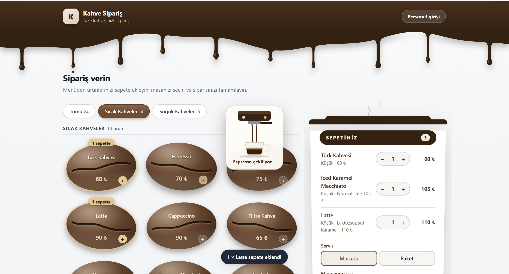
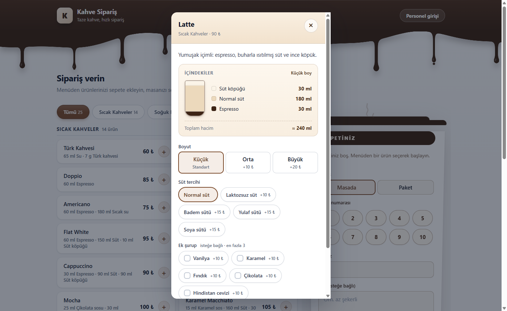
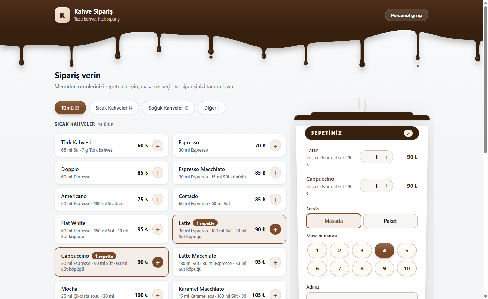
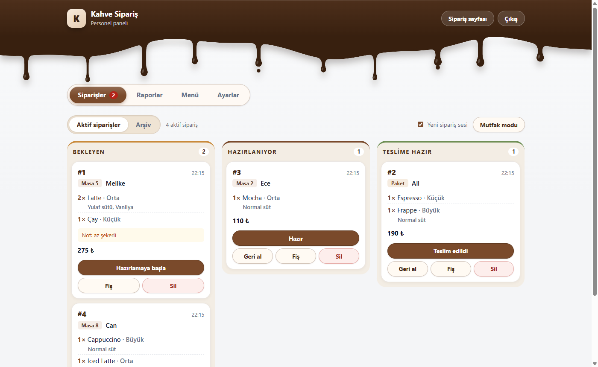
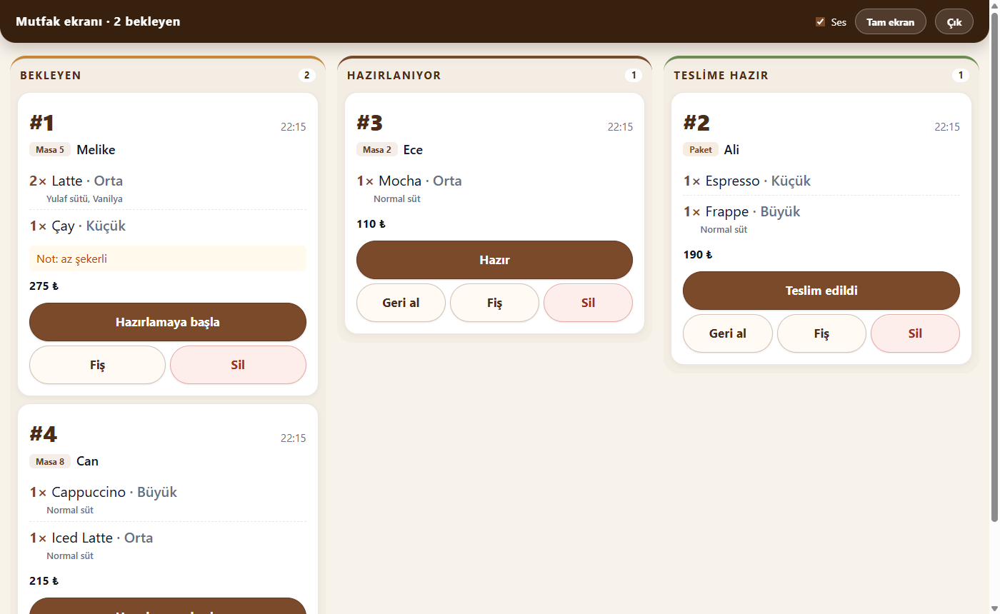
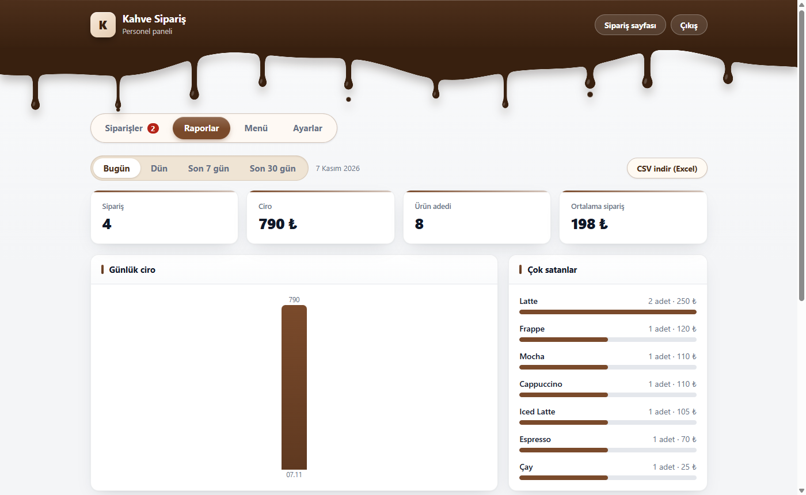
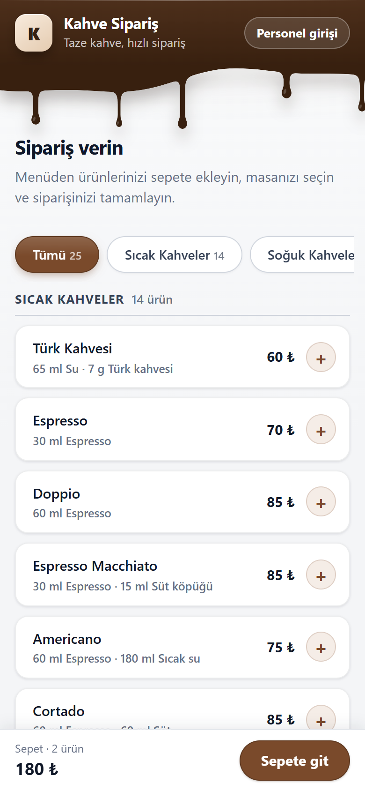

<div align="center">

# ☕ Kahve Sipariş Sistemi

**Kafenizin kendi bilgisayarında çalışan, telefonlardan sipariş alan, menüsü ve siparişleri yönetilebilen modern sipariş sistemi.**

İnternet, hosting, abonelik ya da ek yazılım gerekmez. Bilgisayarınızı açın, aynı Wi-Fi'daki müşteriler masadan sipariş versin.




</div>

---

## İçindekiler

- [Neden bu proje?](#neden-bu-proje)
- [Ekran görüntüleri](#ekran-görüntüleri)
- [Özellikler](#özellikler)
- [Hızlı başlangıç](#hızlı-başlangıç)
- [Nasıl kullanılır?](#nasıl-kullanılır)
- [Nasıl çalışır?](#nasıl-çalışır)
- [Proje yapısı](#proje-yapısı)
- [API](#api)
- [Yapılandırma](#yapılandırma)
- [Veri ve yedekleme](#veri-ve-yedekleme)
- [Güvenlik](#güvenlik)
- [Testler](#testler)
- [Bilinen sınırlamalar](#bilinen-sınırlamalar)
- [Geliştiren](#geliştiren)

---

## Neden bu proje?

Küçük bir kafede sipariş almak için pahalı bir POS sistemine ya da internet altyapısına ihtiyaç olmamalı. Bu proje:

- **Tek komutla** çalışır (`npm start`), kurulum ve hesap gerektirmez.
- **Yerel ağda** çalışır: veriler kafenin kendi bilgisayarında kalır, internete çıkmaz.
- Müşteriye **gerçek bir menü deneyimi** sunar: boyut, süt, şurup, içerik tarifi, canlı fiyat.
- Personele **sipariş panosu, mutfak ekranı, fiş ve raporlar** verir.

## Ekran görüntüleri

<table>
  <tr>
    <td width="50%"><br><sub><b>Ürün penceresi:</b> katmanlı bardak çizimi, ml cinsinden içerik, boyut / süt / şurup seçimi</sub></td>
    <td width="50%"><br><sub><b>Menü kart stili:</b> Klasik (burada), Çekirdek ikonlu ya da Çekirdek şekilli (üstteki görsel); Ayarlar'dan seçilir</sub></td>
  </tr>
  <tr>
    <td><br><sub><b>Personel paneli:</b> Bekleyen → Hazırlanıyor → Teslime hazır panosu</sub></td>
    <td><br><sub><b>Mutfak modu:</b> büyük yazı ve büyük düğmelerle tam ekran pano</sub></td>
  </tr>
  <tr>
    <td><br><sub><b>Raporlar:</b> ciro, çok satanlar, saat dağılımı, CSV indirme</sub></td>
    <td align="center"><br><sub><b>Telefon:</b> alt sepet çubuğu, alttan açılan ürün penceresi</sub></td>
  </tr>
</table>

## Özellikler

### Müşteri tarafı (`/`)

- **Düzenli menü:** *Sıcak Kahveler*, *Soğuk Kahveler* ve *Diğer* bölümleri, sekmelerle filtreleme. Tükenen ürünler "Tükendi" olarak görünür ve seçilemez.
- **25 ürünlük hazır menü:** Türk Kahvesi, Espresso, Doppio, Americano, Cortado, Flat White, Latte, Cappuccino, Mocha, Affogato, Cold Brew, Iced Latte, Frappe, Dalgona, Nitro Cold Brew, Espresso Tonic ve daha fazlası.
- **İçerik tarifleri:** her kartta `30 ml Espresso · 180 ml Süt · 30 ml Süt köpüğü` gibi özet; ürün penceresinde **katmanlı bardak çizimi**, içerik listesi ve toplam hacim. Boyut değişince miktarlar hacim çarpanıyla büyür.
- **Kişiselleştirme:** boyut (Küçük / Orta / Büyük), **süt tercihi** (Normal, Laktozsuz, Badem, Yulaf, Soya), **ek şurup** (içecek başına en fazla 3), adet. Fiyat canlı hesaplanır.
- **Çoklu ürünlü sepet:** tek siparişte birden çok ürün. Sepet sayfa yenilense de korunur; tükenen ürün ya da seçenek otomatik düzeltilir.
- **Masa / paket:** masa numarası hap biçimli düğmelerle seçilir ya da "Paket" denir.
- **Canlı takip:** sipariş numarası (her gün 1'den başlar) ve *Alındı → Hazırlanıyor → Hazır* adım göstergesi.
- **Her ekranda rahat:** telefon, tablet ve masaüstü. Geniş ekranda sepet bardağı sabit durur, yalnızca menü kayar.
- **Küçük sürprizler:** başlıktaki kahve damlaları sepet bardağına damlar; sepete ürün eklenince kısa bir *espresso çekme* animasyonu oynar. "Hareketi azalt" tercihine saygı duyar.

### Personel tarafı (`/admin.html`)

| Bölüm | Ne yapar? |
|---|---|
| **Sipariş panosu** | Siparişler Bekleyen / Hazırlanıyor / Teslime hazır sütunlarında akar. Tek tıkla sonraki aşamaya geçirme, geri alma, silme. Yeni siparişte **sesli uyarı** ve sekme başlığında bekleyen sayısı. |
| **Arşiv** | Teslim edilen siparişler panodan çıkar, arşivde saklanır; panel günlerce çalışsa da hızlı kalır. |
| **Fiş** | Yazdırmadan önce önizleme; 80 mm termal yazıcıya uygun. |
| **Mutfak modu** | Büyük yazı ve büyük dokunma alanıyla tam ekran pano (tablet ya da mutfak ekranı için). |
| **Raporlar** | Bugün / dün / son 7 / son 30 gün: sipariş, ciro, ürün adedi, ortalama sipariş; günlük ciro ve saat dağılımı grafikleri, çok satanlar, masa/paket oranı, en çok seçilen süt ve şuruplar. **Excel uyumlu CSV indirme.** |
| **Menü yönetimi** | Ürün ekleme/silme; ad, kategori, fiyat düzenleme; "tükendi" işaretleme; boyut ve ek ücretler; ürün başına süt/şurup seçeneğini açma-kapama; süt ve şurup listeleri. |
| **Tarif düzenleme** | Her ürün için açıklama ve içerik listesi (ad, miktar, ml/g, alttan üste sıra) ve canlı bardak önizlemesi. |
| **Ayarlar** | Kafe adı, slogan, **4 renk teması** (Kahve, Zeytin, Lacivert, Bordo), **menü kart stili**, masa sayısı. Müşteri sayfasına, sekme başlığına ve fişe yansır. |

### Tasarım

Tek bir tasarım sistemi: kahve ve krem renkler, hap biçimli düğmeler ve sekmeler, düz renkli (gradyansız) yüzeyler, koyu kahve damlalı üst bar ve kahve bardağı biçiminde sepet. Müşteri sayfası, personel paneli ve mutfak ekranı aynı görünümü paylaşır; renk teması hepsini birlikte değiştirir.

## Hızlı başlangıç

**Gereksinim:** [Node.js](https://nodejs.org) 22.5 veya üstü.

```bash
git clone https://github.com/melikekumanli/KAHVE-SIPARIS-SISTEMI.git
cd KAHVE-SIPARIS-SISTEMI
npm install
npm start
```

> **Windows'ta tek tıkla:** `baslat.bat` dosyasına çift tıklayın. İlk seferde paketleri kurar, tarayıcıyı açar.

Sunucu açılınca konsolda şuna benzer bir çıktı görürsünüz:

```
  Bu bilgisayardan : http://localhost:3000
  Ağdaki cihazlar  : http://192.168.1.20:3000
  Barista paneli   : /admin.html
  Barista anahtarı : 9c6ab2bbbc72
```

> **Windows Güvenlik Duvarı:** İlk çalıştırmada "Node.js'in ağ erişimine izin verilsin mi?" diye sorar. Telefonların bağlanabilmesi için **Özel ağlar**'a izin verin.

## Nasıl kullanılır?

1. **Müşteriler** telefondan "Ağdaki cihazlar" adresini açar (aynı Wi-Fi'da olmalıdır). Bu adresi QR koda çevirip masalara koyabilirsiniz.
2. **Personel** aynı adrese `/admin.html` ekleyerek girer ve konsoldaki **barista anahtarını** yazar. Anahtar `data/admin-token.txt` dosyasında da saklanır.
3. **Siparişler** panoya düşer. Sesli uyarı çalar; "Hazırlamaya başla" → "Hazır" → "Teslim edildi" ile ilerletilir. Müşteri kendi telefonunda durumu canlı görür.
4. **Menüyü** Personel paneli → *Menü* sekmesinden değiştirin: fiyat, tükendi işareti, yeni ürün, tarif.
5. **Görünümü** *Ayarlar* sekmesinden seçin: kafe adı, renk teması, kart stili.

## Nasıl çalışır?

```
 Müşteri telefonu ─┐                      ┌── Sipariş panosu / Mutfak / Raporlar
 Personel tableti ─┼── Wi-Fi ──►  Node.js + Express  ◄──┘
                   │              (API + statik dosyalar)
                   │                      │
                   │                      ▼
                   │               SQLite (data/orders.db)
```

- **Tek program, tek port:** Express hem API'yi hem `frontend/` dosyalarını sunar.
- **Veritabanı:** Node'un yerleşik `node:sqlite` modülü. Ayrı bir veritabanı sunucusu yok; tüm veri tek dosyada.
- **Frontend:** derleme adımı olmayan sade HTML, CSS ve JavaScript.
- **Güncel kalma:** müşteri ve personel ekranları durumu birkaç saniyede bir yoklar.
- **Sürüm geçişleri:** veritabanı açılışta kendini yükseltir (yeni sütunlar, tarifler, kategori adları). Sizin yaptığınız değişiklikler ezilmez.

| Katman | Teknoloji |
|---|---|
| Frontend | HTML, CSS, vanilla JavaScript |
| Backend | Node.js (≥ 22.5) + Express 5 |
| Veritabanı | SQLite (`node:sqlite`) |
| Test | `node:test` (yerleşik) |

Yalnızca iki paket bağımlılığı vardır: `express` ve `cors`.

## Proje yapısı

```
KAHVE-SIPARIS-SISTEMI/
├── backend/
│   ├── server.js        # Sunucuyu başlatır (port, ağ adresleri, barista anahtarı)
│   ├── app.js           # Express uygulaması: tüm uç noktalar
│   ├── db.js            # SQLite bağlantısı, tablolar, varsayılan menü, sürüm geçişleri
│   ├── menu.js          # Menü işlemleri ve doğrulama
│   ├── orders.js        # Sepet doğrulama, sipariş kaydı, rapor ve CSV
│   ├── settings.js      # Marka ayarları (ad, slogan, tema, kart stili, masa sayısı)
│   ├── rateLimiter.js   # Hız sınırlayıcı
│   └── api.test.js      # API testleri
├── frontend/
│   ├── index.html, script.js   # Müşteri sayfası
│   ├── admin.html, admin.js    # Personel paneli ve mutfak modu
│   ├── brand.js                # Kafe adı, tema ve damlalı başlık (iki sayfada ortak)
│   ├── recipe.js               # Tarif özeti ve katmanlı bardak çizimi
│   ├── fx.js                   # Damla ve espresso çekme animasyonları
│   └── style.css               # Tasarım sistemi (renk değişkenleri, temalar, yazdırma)
├── docs/screenshots/    # README görselleri
├── data/                # Veritabanı ve barista anahtarı (otomatik oluşur, git'e girmez)
├── baslat.bat           # Tek tıkla başlatma (Windows)
└── package.json
```

## API

| Metot | Adres | Erişim | Açıklama |
|---|---|---|---|
| GET | `/api/menu` | Herkes | Ürünler, boyutlar, süt ve şuruplar |
| POST | `/api/orders` | Herkes | Yeni sipariş |
| GET | `/api/orders/:id` | Herkes | Tek siparişin durumu (id tahmin edilemez bir UUID'dir) |
| GET | `/api/orders` | Barista | Siparişler. Filtreler: `?scope=active`, `?status=Hazır`, `?limit=100` |
| PATCH | `/api/orders/:id/status` | Barista | Sipariş durumunu günceller |
| DELETE | `/api/orders/:id` | Barista | Siparişi siler |
| POST | `/api/menu/items` | Barista | Ürün ekler |
| PATCH | `/api/menu/items/:id` | Barista | Ürünü günceller (ad, kategori, fiyat, `available`, `allowsMilk`, `allowsSyrup`, `description`, `recipe`) |
| DELETE | `/api/menu/items/:id` | Barista | Ürünü siler |
| PUT | `/api/menu/sizes` | Barista | Boyut listesi (`{ sizes: [{ name, extra, scale }] }`) |
| PUT | `/api/menu/milks` | Barista | Süt listesi (`{ options: [{ name, extra, available }] }`) |
| PUT | `/api/menu/syrups` | Barista | Şurup listesi (aynı biçim) |
| GET | `/api/settings` | Herkes | Kafe adı, slogan, tema, menü stili, masa sayısı |
| PUT | `/api/settings` | Barista | Marka ayarlarını ve masa sayısını günceller |
| GET | `/api/reports` | Barista | Özet rapor: `?from=<ISO>&to=<ISO>` (en fazla 93 gün) |
| GET | `/api/reports/orders.csv` | Barista | Aynı aralığın siparişleri, Excel uyumlu CSV |

Barista uçları `x-admin-token` başlığı ister; yanlışsa `401`, çok fazla hatalı denemede `429` döner.

<details>
<summary><b>Sipariş gövdesi ve kuralları</b></summary>

```json
{
  "name": "Melike",
  "note": "az şekerli",
  "items": [
    { "type": "Latte", "size": "Orta", "qty": 2, "milk": "Yulaf sütü", "syrups": ["Vanilya", "Karamel"] },
    { "type": "Çay", "size": "Küçük", "qty": 1 }
  ],
  "service": "Masa",
  "table": 5
}
```

- `items`: 1-20 satır, satır başına 1-20 adet, toplam en fazla 50. Ürün ve boyut menüde var olmalı, tükenmiş ürün sipariş edilemez. Aynı ürün + boyut + seçenek satırları birleştirilir.
- `service`: `"Masa"` (`table` 1..masa sayısı) ya da `"Paket"`. Masa sayısı 0 ise gerekmez.
- `milk` yalnızca süt seçeneği açık ürünlerde, `syrups` (en fazla 3) yalnızca şurup seçeneği açık ürünlerde kabul edilir. Süt gönderilmezse listedeki ilk mevcut süt atanır.
- Birim fiyat = ürün + boyut + süt + şuruplar. **Fiyat ve durum istemciden alınmaz, sunucu hesaplar.**
- Hatalarda `400` ve `{ "errors": ["..."] }` döner.

</details>

<details>
<summary><b>Tarif biçimi</b></summary>

`recipe`, ürünün PATCH/POST gövdesinde gönderilir: en fazla 8 satır, sıra bardağa **alttan üste** ekleme sırasıdır; `description` en fazla 160 karakter.

```json
{ "description": "Yumuşak içimli latte.",
  "recipe": [ { "name": "Espresso", "amount": 30, "unit": "ml" },
              { "name": "Süt", "amount": 180, "unit": "ml" },
              { "name": "Süt köpüğü", "amount": 30, "unit": "ml" } ] }
```

Miktarlar standart (ilk) boy içindir; `unit` `ml` ya da `g` olabilir. Müşteri ekranında miktarlar seçilen boyun `scale` değeriyle çarpılır (ml 5'in katlarına yuvarlanır).

</details>

## Yapılandırma

Hiçbir ayar zorunlu değildir; `.env` dosyası gerekmez. İsterseniz ortam değişkenleriyle değiştirebilirsiniz:

| Ortam değişkeni | Varsayılan | Açıklama |
|---|---|---|
| `PORT` | `3000` | Sunucu portu |
| `ADMIN_TOKEN` | otomatik üretilir | Barista anahtarını kendiniz belirlemek için |
| `DB_PATH` | `data/orders.db` | Veritabanı dosyasının yolu |
| `ALLOWED_ORIGIN` | (yok) | Frontend'i başka bir adresten sunacaksanız CORS izni (virgülle ayrılır) |

Örnek (PowerShell): `$env:PORT=8080; npm start`

## Veri ve yedekleme

Tüm veri (siparişler, menü, ayarlar) `data/orders.db` dosyasındadır. **Yedeklemek için sunucu kapalıyken `data/` klasörünü kopyalamanız yeterlidir.** Yeni bir bilgisayara taşırken de aynısını yapın. Menüyü değiştirmek eski siparişleri bozmaz: siparişte ürün adı ve fiyat kopyası saklanır.

## Güvenlik

- Barista anahtarı ilk açılışta **rastgele üretilir**; tahmin edilebilir varsayılan yoktur. Karşılaştırma zamanlama saldırısına dayanıklıdır.
- Hatalı anahtar denemeleri ve aşırı sipariş gönderimi **hız sınırıyla** engellenir.
- Fiyat her zaman **sunucuda** hesaplanır; istemci fiyatı ya da durumu değiştiremez.
- Tüm girdiler sunucuda doğrulanır; veritabanı sorguları hazır ifadelerle (prepared statements) yapılır.
- CSV dışa aktarımı **formül enjeksiyonuna** karşı korumalıdır (Excel'de `=` ile başlayan hücreler etkisizleştirilir).
- CORS varsayılan olarak kapalıdır, yalnızca izin verdiğiniz adrese açılır.

## Testler

```bash
npm test
```

59 otomatik API testi: sepet ve seçenek doğrulama, yetki, hız sınırı, arşiv, rapor, CSV güvenliği, tarifler, menü bölümleri ve eski veritabanlarının yükseltilmesi. Ek paket gerekmez, Node'un yerleşik test çalıştırıcısı kullanılır.

## Bilinen sınırlamalar

- Tek paylaşılan barista anahtarı vardır; kullanıcı hesabı ve oturum yönetimi yoktur. **Sunucuyu internete açmayın**: yerel ağ için tasarlanmıştır (trafik şifrelenmez, HTTPS yoktur).
- Müşteri siparişlerini tarayıcısında hatırlar; başka cihazdan görünmez.
- Durum takibi ve yeni sipariş bildirimi birkaç saniyelik yoklamayla yapılır (anlık değildir).
- Ödeme (online ya da kasa) yoktur; ciro raporu siparişlere dayanır, tahsilat takibi yapılmaz.
- Raporlardaki gün ve saatler sunucu bilgisayarın yerel saatine göredir.
- Logo yüklenmez; logo yerine kafe adının baş harfi kullanılır.
- `node:sqlite` Node'da henüz deneysel olarak işaretlidir.

## Geliştiren

**Melike Kumanlı** 

